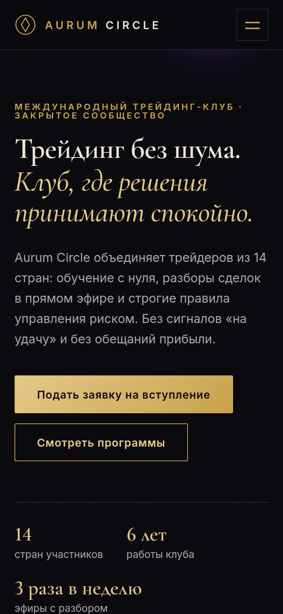

# Aurum Circle: сайт трейдинг-клуба

Презентационный сайт закрытого клуба трейдеров в стиле «old money». Цель страницы: заявка на вступление.

**Демо:** https://club.myfreelab.ru

<p>
  
  
</p>

## Задача

Заказ с FL.ru от 17.10.2026: одностраничный сайт международного трейдинг-клуба. Премиальный стиль, чёрный, фиолетовый и золотой, десять блоков. Сайт должен вызывать доверие и вести к вступлению в клуб. Личные кабинеты, регистрация и платежи в заказ не входили. Это учебный кейс для портфолио, заказчику ничего не отправлялось. Разбор заказа, тексты и референсы: [CASE.md](CASE.md).

## Что сделано

- Десять блоков по ТЗ: первый экран, о клубе, преимущества, программы, результаты, отзывы, как вступить, вопросы, заявка, подвал.
- Придуманы название и тексты, знак клуба нарисован в SVG.
- Три программы: «Старт», «Практика», «Закрытый круг». Путь вступления в четыре шага.
- Правила риска вместо громких обещаний: предупреждение о риске потери капитала на первом экране и в подвале, без гарантий доходности.
- Форма заявки: имя, Telegram или телефон, опыт в трейдинге, комментарий. Заявка уходит в Google Таблицу, есть скрытое поле-ловушка для ботов.
- Вёрстка под телефон и компьютер, меню для телефона. Анимации появления отключаются, если в системе включено уменьшение движения.

## Стек

HTML, CSS и JavaScript без сборки и сторонних библиотек. Шрифты Cormorant Garamond и Inter лежат в репозитории. Приём заявок: Google Apps Script.

## Запуск

Сборки нет. Для просмотра достаточно любого статического сервера:

```bash
python3 -m http.server 8000
```

Сайт откроется на http://localhost:8000.

## Состав

```text
index.html                   страница
css/styles.css               стили и подключение шрифтов
js/main.js                   меню, анимация, форма заявки
fonts/                       Cormorant Garamond и Inter (кириллица и латиница)
google-apps-script/Code.gs   приём заявок в Google Таблицу
favicon.svg
CASE.md                      разбор заказа, тексты, референсы
docs/                        скриншот заказа и снимки сайта
```

## Подключить приём заявок

1. Разверните `google-apps-script/Code.gs` как веб-приложение (подробно в CASE.md, раздел 10).
2. Вставьте полученный URL в `js/main.js`, в `SITE_CONFIG.googleSheetsUrl`.

Все цифры, цены и отзывы на странице демонстрационные.
